# MacBook Pro M3 Landing Page

An Apple-style product landing page for the MacBook Pro M3, built with React, Three.js and GSAP. It features an interactive 3D product viewer, scroll-driven animations, and video-textured models.

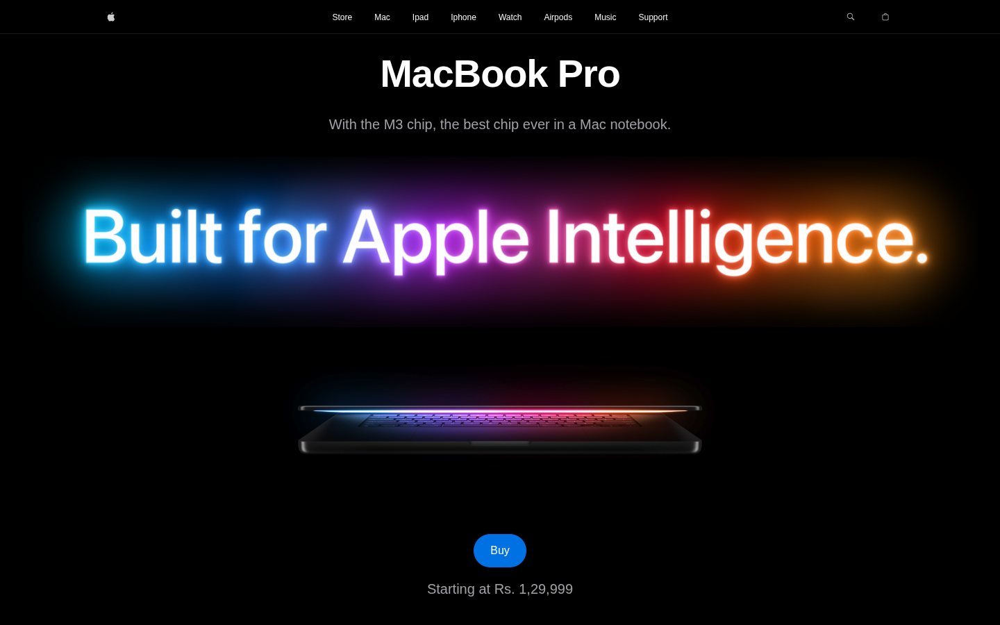

## Tech Stack

- [React 19](https://react.dev) + [Vite 7](https://vite.dev)
- [Tailwind CSS 4](https://tailwindcss.com)
- [GSAP](https://gsap.com) with ScrollTrigger
- [React Three Fiber](https://r3f.docs.pmnd.rs) + [Drei](https://drei.docs.pmnd.rs)
- [Zustand](https://zustand.docs.pmnd.rs) for shared model state

## Sections

### Hero

Autoplaying intro video with the product name and a buy call to action.

### Take a Closer Look

An interactive 3D MacBook. Drag to orbit the model, switch between Silver and Space Black, and toggle the 14" and 16" sizes.

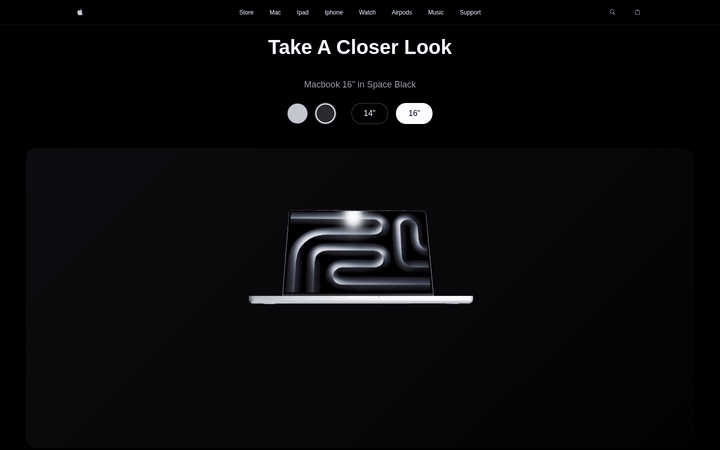

### Showcase

A pinned, scroll-scrubbed section where the M4 mask expands to reveal a full-screen video.

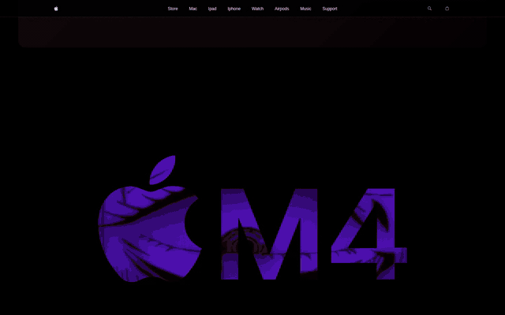

### Performance

Images fly in and out around the "Extreme Performance" heading as you scroll, in both directions.

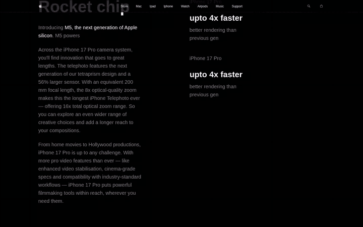

### Powerful Features

The MacBook rotates a full turn as you scroll, with its screen texture and the feature callouts changing at each step over an interactive floating-lines background.

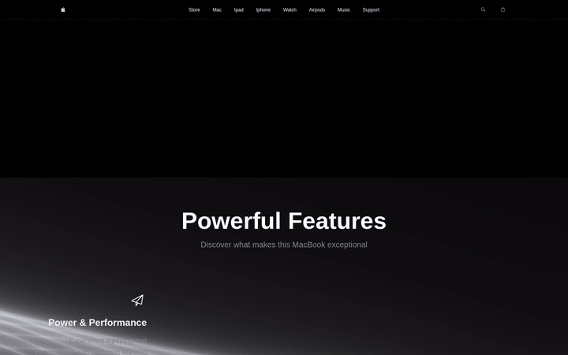

### Highlights

The headline, subtitle and highlight list animate in on scroll over the M3 artwork.

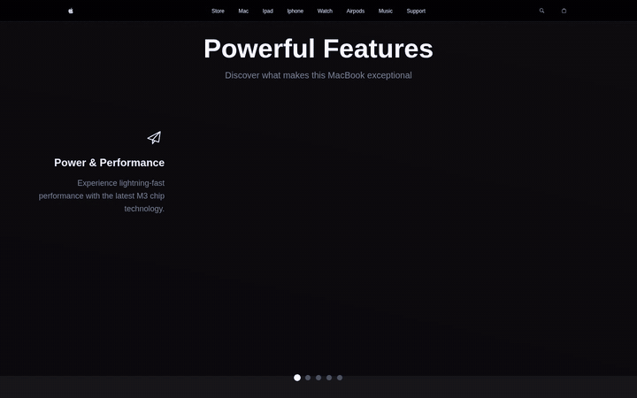

### Footer

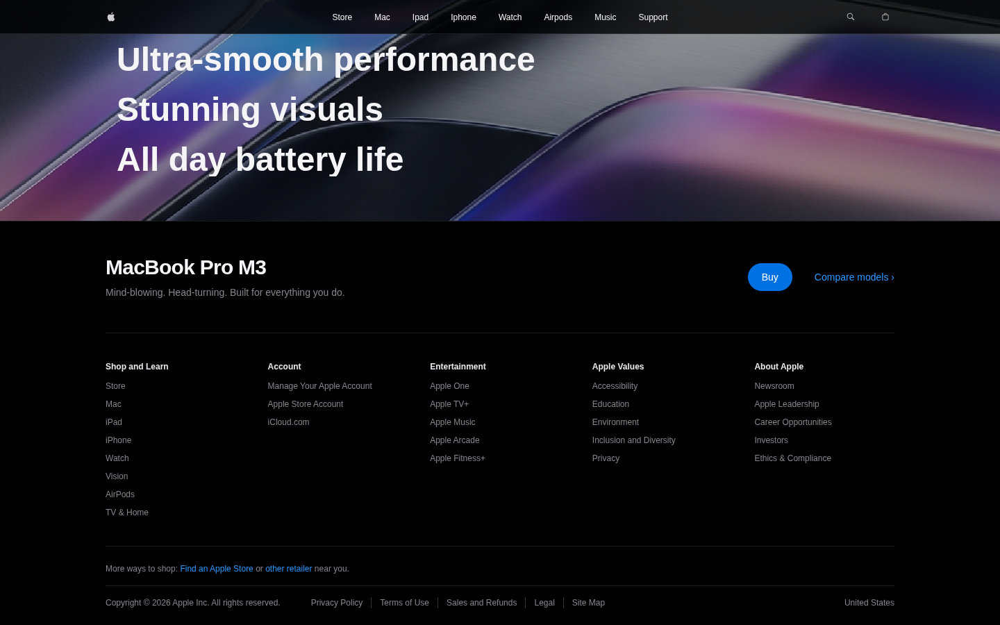

## Screenshots

| Product Viewer | Showcase |
| --- | --- |
| 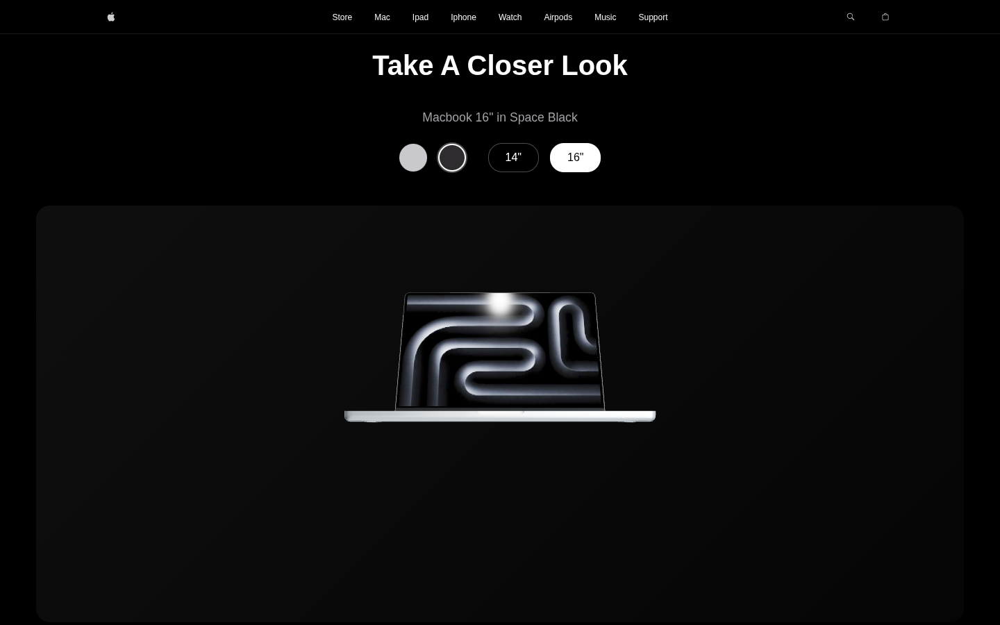 | 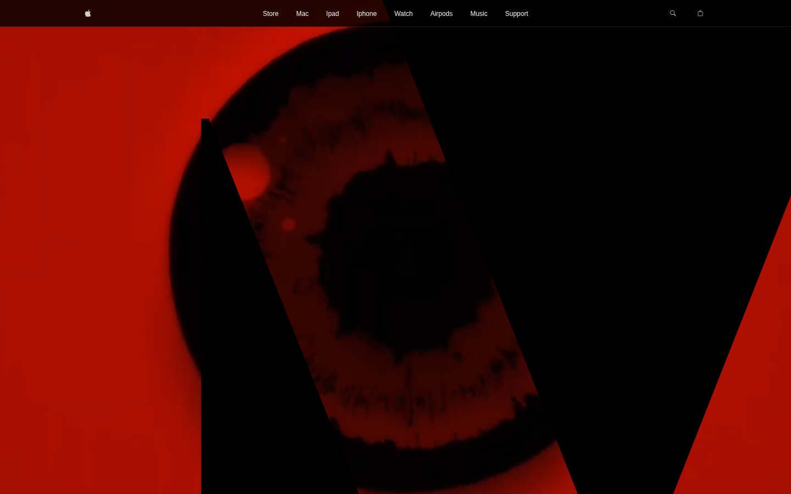 |
| **Performance** | **Features** |
| 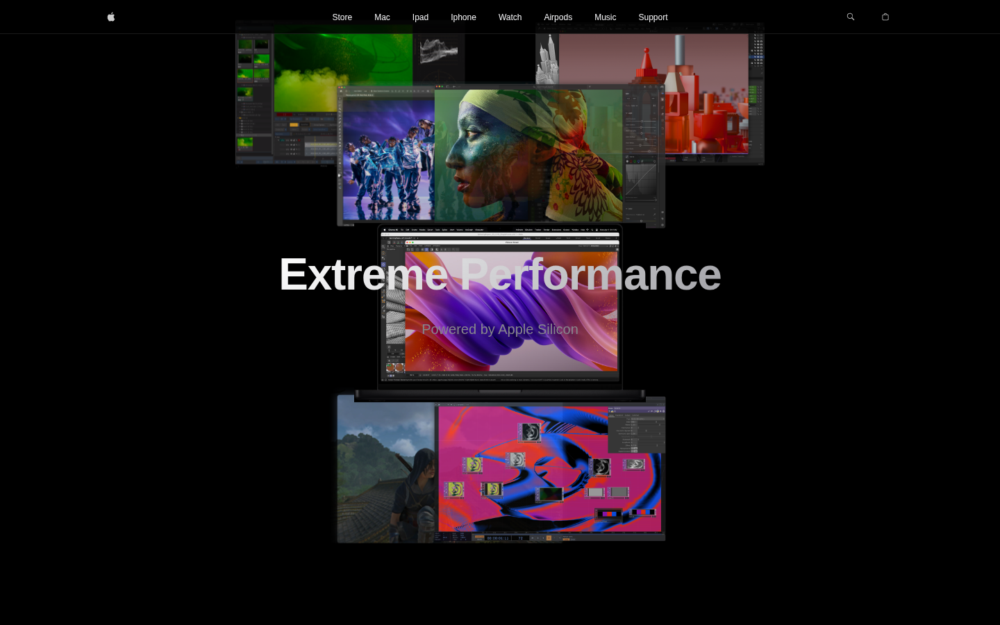 | 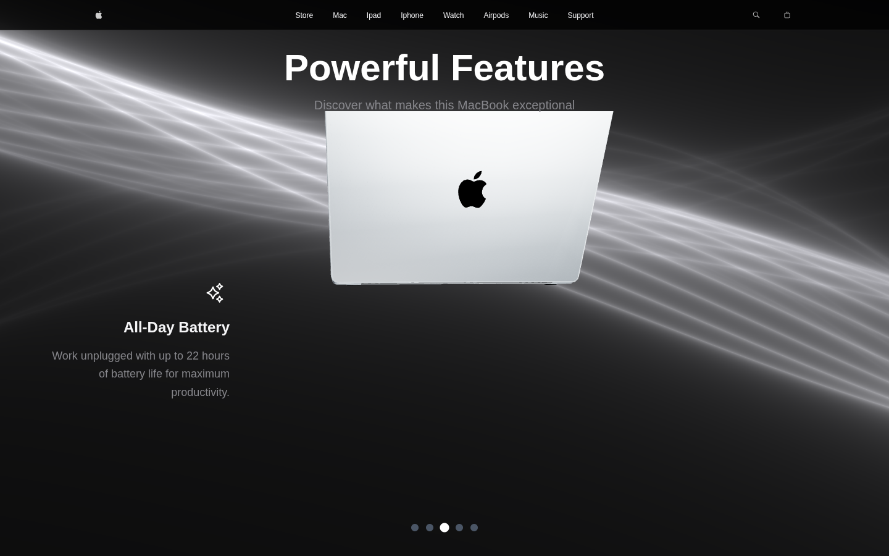 |
| **Highlights** | **Footer** |
| 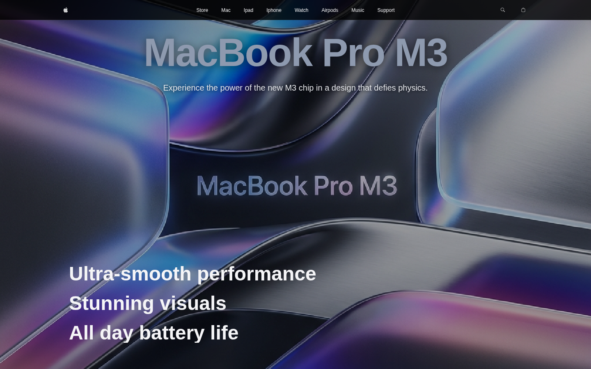 |  |

## Scripts

| Command | Description |
| --- | --- |
| `npm run dev` | Start the development server |
| `npm run build` | Build for production into `dist/` |
| `npm run preview` | Preview the production build |
| `npm run lint` | Run ESLint |
